# SolidFerry

## Fast, robust, native Android file transfer for Mac.

[English](README.md) | 한국어

[](https://github.com/Jongsic/SolidFerry/actions/workflows/ci.yml)
[](https://github.com/Jongsic/SolidFerry/releases)
[](LICENSE)


폰을 Finder 창처럼 둘러보고, 파일을 양방향으로 옮기고, 사진과 동영상을 기기에서 바로 엽니다.
USB(MTP 또는 ADB)와 Wi-Fi로 연결합니다. Swift와 SwiftUI로 만들었고 MTP·ADB 클라이언트를 직접
구현했습니다. Electron도, 커널 확장도 없고, 폰에 설치할 것도 없습니다.

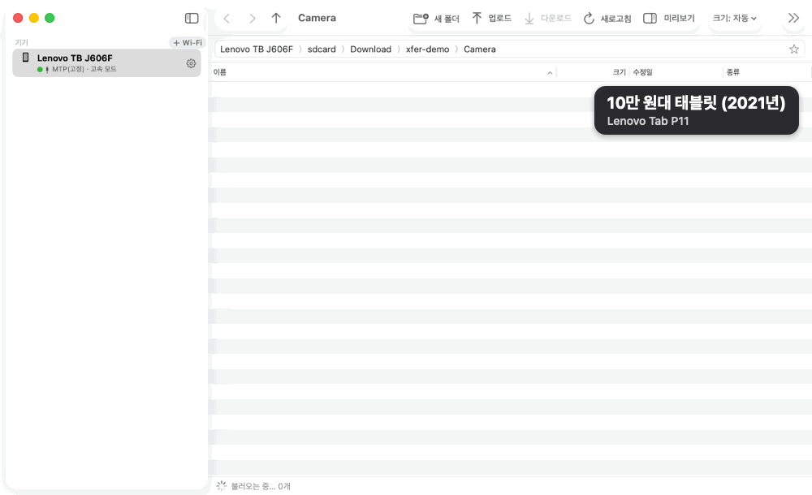

## 왜 또 하나를 만들었나

저도 [OpenMTP](https://github.com/ganeshrvel/openmtp)를 정말 많이 썼고 여러 번 도움을 받았습니다.
그래서 더 존경하는 앱이고, Google의 Android File Transfer와 함께 널리 쓰여 온 오픈소스
프로젝트입니다. 하지만 파일이 수천 개인 폴더(주로 카메라 폴더)는 목록이 뜨기까지 오래 걸리고,
Shift-클릭으로 범위를 선택하는 기능은 [2023년부터 요청만 열려 있습니다](https://github.com/ganeshrvel/openmtp/issues/316). 잘 알려진
다른 앱들은 유료이고, Android File Transfer는 있던 시절에도 큰 폴더에서 수십 초씩 멈춰 있곤
했습니다. 그래서 제가 쓰고 싶은 앱을 직접 만들었습니다.

앱마다 성능을 하나하나 비교하기는 어렵지만, SolidFerry는 충분히 만족하며 쓸 수 있는 속도에 편리한
기능과 옵션을 두루 갖췄습니다. 종합적으로 보면 지금 고를 수 있는 가장 괜찮은 선택이 될 거라고
생각합니다.

## 기능

### 큰 폴더도 빠르게.

위 화면은 2021년에 10만 원 정도에 팔리던 태블릿 Lenovo Tab
P11에서 사진 10,000장 폴더를 여는 모습입니다. 우리가 테스트하는 기기 중 가장 느린 기기인데도,
MTP로 10,000개 파일 목록이 1.9초 만에 다 떠서 바로 스크롤하고 선택하고 내려받을 수 있습니다.
최신 폰은 아니고 지금 기준으로는 중급기 정도인 Galaxy S23·Z Flip5(2023년)에서는
0.5초도 걸리지 않습니다([성능](#성능) 참고). Shift-클릭 범위 선택, 정렬, 여러 창은 Finder와 똑같이
동작하고, 파일이 수만 개인 폴더도 ⌘F로 이름을 입력하는 대로 바로 검색할 수 있습니다(정규식도 됩니다).

### 큰 파일도 바로 열기 — 몇 GB짜리 동영상도.

사진, 동영상, 음악은 기기에서 바로 읽어 보여 주는
보기 창에서 열립니다. 폰에서 직접 재생하듯, 같은 10만 원짜리 태블릿에서 1.8 GB 동영상이 1초쯤이면
재생되고(Galaxy Z Flip5에서는 0.2초), 파일을 먼저 받지 않고도 원하는 위치로 바로 이동합니다.
재생 중에 케이블이 빠져도 기기가 다시 연결되면 이어서 재생합니다. Finder의 훑어보기처럼 스페이스를
누르면 선택한 파일을 보여 주고, 한 번 더 누르면 닫습니다.

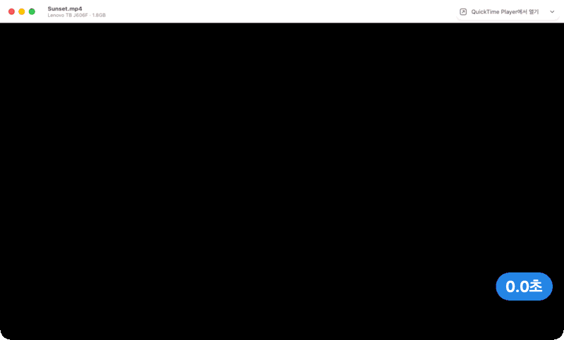

### 목록 옆 미리보기.

사진(폰이 이미 가지고 있는 썸네일이 있으면 그것을 씀), 동영상의 한 장면과
길이·해상도, 텍스트, PDF 첫 쪽, 음악 표지, 그리고 기기가 알려 주는 모든 정보를 보여 줍니다.
미리보기가 어디까지 할지도 정할 수 있습니다. 패널을 켜고 끄고, 기기에서 아예 읽지 않게 하거나(그러면
목록에 있는 정보만 보여 줌), 모든 정보를 묶음별로 또는 원래 태그 그대로 보고, 통째로 읽을 파일 크기를
정할 수 있습니다.

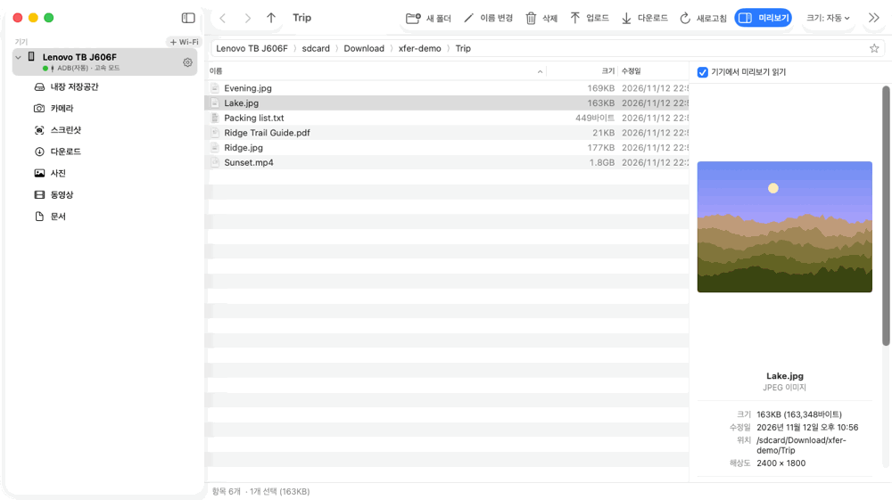

### 믿을 수 있는 전송.

- Mac → 기기, 기기 → Mac, 기기 → 기기. 끌어 놓기, 복사·붙여넣기, 메뉴 어느 쪽으로 해도 하나의
  전송 대기열에 들어가 진행률, 일시정지, 재개, 실패한 파일 다시 시도를 지원합니다. 대기열은 앱을
  종료해도 남고, 연결이 끊기면 기다렸다가 이어 갑니다.
- 기존 파일을 잃지 않습니다. 건너뛰기, 덮어쓰기, 둘 다 유지, 또는 크기·날짜·내용으로 판단하기 중에
  고를 수 있고, 시작하기 전에 무엇이 복사되고 건너뛰고 바뀌는지 미리 보여 줍니다. 덮어쓰기는 새
  파일을 끝까지 받은 뒤에만 원본을 바꿉니다.
- 받은 파일의 날짜를 바꿔 버리는 폰에는 원래 날짜가 유지되는 ZIP 하나로 보낼 수 있습니다.

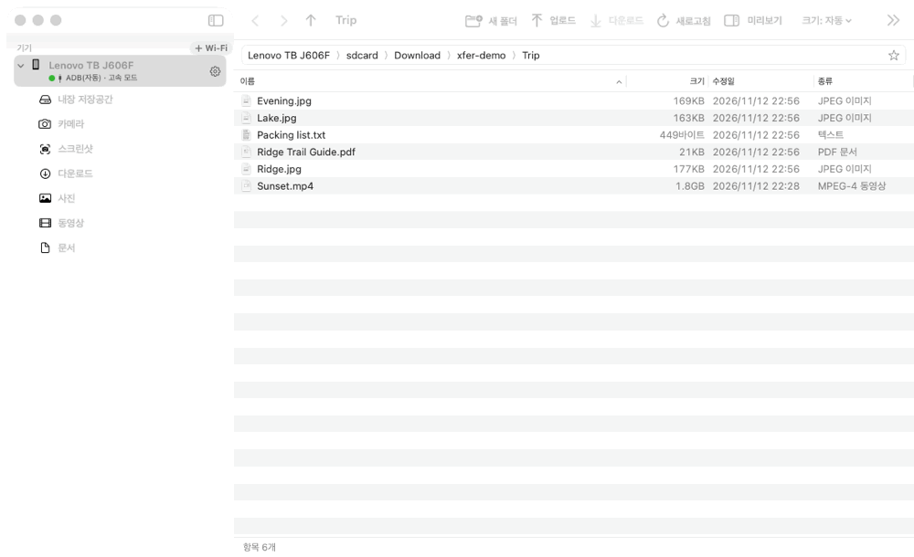

### 번거롭지 않은 연결.

폰을 꽂으면 바로 나타납니다. USB 디버깅이 켜져 있으면 ADB(더 빠르고, 일부
문제는 앱이 직접 고칩니다)를, 아니면 모든 폰에 있는 "파일 전송" 모드인 MTP를 씁니다. Wi-Fi는
무선 디버깅으로 연결하며, 한 번 페어링하면 그다음부터는 자동으로 연결됩니다. 충전 전용 모드, 사진
서비스가 폰을 잡고 있는 경우, 폰에서 허용을 기다리는 경우처럼 뭔가 막고 있으면 무엇이 문제이고
무엇을 하면 되는지 알려 줍니다.

### 기기에서 정리.

새 폴더, 이름 바꾸기, 여러 파일 이름 한 번에 바꾸기(찾아 바꾸기, 번호, 대소문자),
삭제, 숨김 파일 보기. 사이드바에는 기기마다 자주 쓰는 폴더, SD 카드나 USB 드라이브, 직접 추가한
폴더(오른쪽 클릭 ▸ 사이드바에 추가)가 나옵니다.

### 탭, 여러 창, 그리고 그 사이 끌어 놓기.

폴더를 탭이나 별도 창으로 열 수 있고, 한 기기든 여러
기기든 그 사이로 파일을 끌어 놓으면 됩니다. Finder에서 폰으로, 폰에서 Finder로, 심지어 폰에서 다른
폰으로 바로 옮길 수도 있습니다.

<table>
<tr>
<td colspan="2">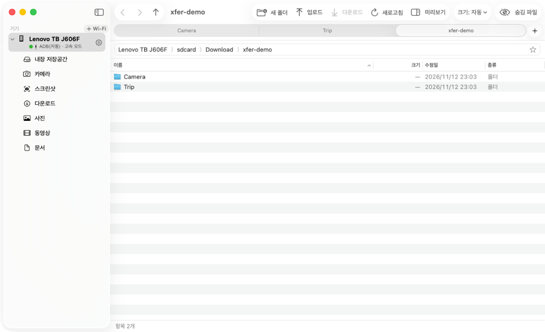<br><sub>탭과 여러 창</sub></td>
</tr>
<tr>
<td width="50%">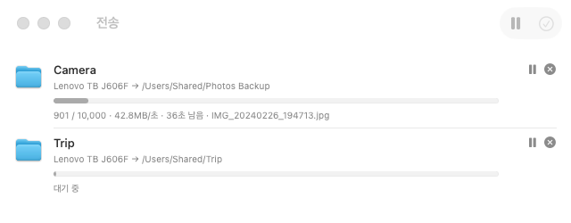<br><sub>모든 전송이 하나의 대기열로</sub></td>
<td width="50%">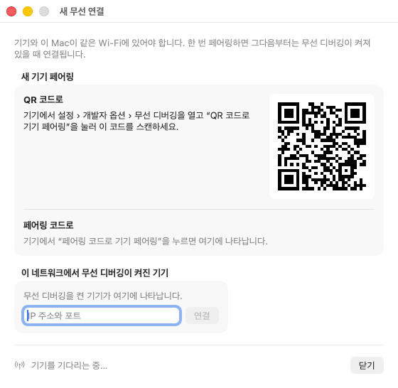<br><sub>Wi-Fi: QR 코드로 한 번만 페어링</sub></td>
</tr>
</table>

### 동작을 고르는 설정.

날짜를 바꾸는 폰에도 원래 날짜를 지켜 보내기, 작은 파일 여러 개를 한 번에
묶어 받기, 임시 파일을 거치지 않고 기기에 바로 쓰기 같은 전송 옵션이 있습니다. 반응성을 위한 옵션도
있습니다. 보기 창과 미리보기가 직접 읽을 파일 크기를 정할 수 있고, 폰을 꽂자마자 macOS 사진 서비스가
폰을 잡지 못하게 해서 첫 폴더가 바로 뜨게 할 수 있습니다. 글자 크기는 창의 부분마다 정할 수 있습니다.

<table>
<tr>
<td width="50%">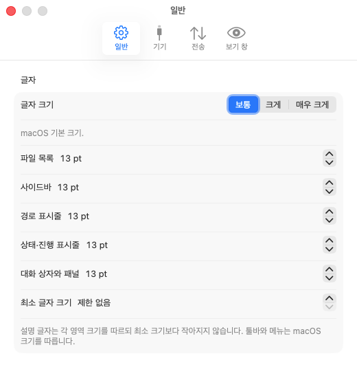<br><sub>일반: 창의 부분마다 글자 크기</sub></td>
<td width="50%">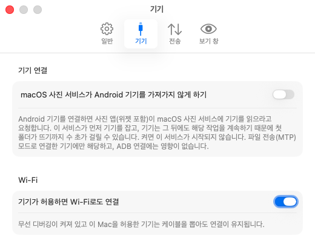<br><sub>기기: macOS 사진 서비스, Wi-Fi</sub></td>
</tr>
<tr>
<td>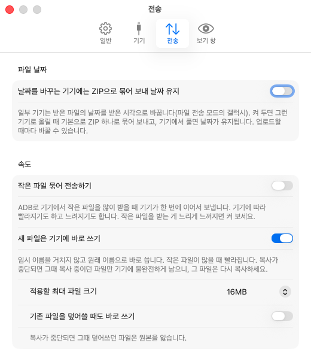<br><sub>전송: 파일 날짜와 속도</sub></td>
<td>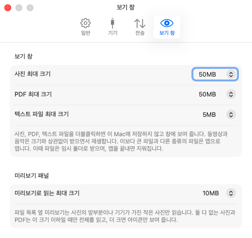<br><sub>보기 창: 앱에서 바로 여는 크기, 미리보기가 읽는 크기</sub></td>
</tr>
</table>

영어와 한국어를 지원합니다.

## 성능

USB 연결, 3회 측정의 중앙값입니다. 2021년에 10만 원 정도 하던 태블릿 Lenovo Tab
P11이 우리가 테스트하는 기기 중 가장 느린 쪽이고, Galaxy Z Flip5와 S23(2023년)은
최신은 아니고 지금 기준으로 중급기 정도입니다.

| 기기 | 연결 | 사진 10,000장 폴더: 첫 항목 | 둘러볼 준비 완료 | 1.8 GB 동영상: 재생 시작 |
|---|---|---|---|---|
| Galaxy S23 (2023년) | ADB | 0.05초 | 0.9초 | 0.2초 |
| Galaxy S23 (2023년) | MTP | 0.2초 | 0.2초 | 0.3초 |
| Galaxy Z Flip5 (2023년) | ADB | 0.04초 | 1.9초 | 0.2초 |
| Galaxy Z Flip5 (2023년) | MTP | 0.4초 | 0.4초 | 0.2초 |
| Lenovo Tab P11 (2021년, 10만 원대 태블릿) | ADB | 0.2초 | 4.1초 | 1.2초 |
| Lenovo Tab P11 (2021년, 10만 원대 태블릿) | MTP | 1.9초 | 1.9초 | 0.7초 |

"둘러볼 준비 완료"는 10,000개 항목이 모두 목록에 올라 스크롤, 선택, 내려받기를 할 수 있게 된
시점입니다. MTP에서는 이름이 먼저 오고 크기와 날짜는 뒤에서 채워집니다. ADB는 크기와 날짜가 이름과
함께 오므로, ADB의 "둘러볼 준비 완료"는 모든 정보가 다 온 시점입니다. 폴더 시간은 앱과 같은
방식으로 목록을 읽는 개발용 CLI(`sferry ls`, `sferry mtpfs ls`)로 쟀고, 동영상 시간은 앱에서
파일을 연 순간부터 화면이 움직이기 시작할 때까지입니다.

## 설치

[Releases](https://github.com/Jongsic/SolidFerry/releases)에서 DMG를 받아 SolidFerry를
응용 프로그램 폴더로 끌어 놓습니다. macOS 14 이상(Apple Silicon, Intel)이 필요합니다.

아직 공증(notarization)을 받지 않은 빌드라서 처음 실행할 때 macOS가 한 번 경고합니다.

- **macOS 15 이상**: SolidFerry를 열고 경고 창에서 **완료**를 누릅니다. 그다음
  **시스템 설정 ▸ 개인정보 보호 및 보안**에서 *"SolidFerry"이(가) 차단되었습니다…* 옆의
  **확인 없이 열기**를 누릅니다.
- **macOS 14**: SolidFerry.app을 오른쪽 클릭 ▸ **열기**, 다시 **열기**를 누릅니다.

**폰에서는** 둘 중 하나를 하면 됩니다.
- 꽂은 뒤 USB 알림에서 **파일 전송**을 고릅니다(MTP).
- 개발자 옵션에서 **USB 디버깅**을 켭니다(ADB). `adb`가 설치되어 있지 않으면 SolidFerry가 이 앱에서
  쓸 Google platform-tools를 받아 줍니다.

## 기기 테스트에 함께해 주세요

SolidFerry는 한 사람이 몇 안 되는 기기로 만들고 있습니다. Galaxy 폰 몇 대, Lenovo 태블릿, Teclast
태블릿이 전부입니다([테스트한 기기](docs/DEVICE_TESTS.md#results-by-device)). Android 제조사마다
MTP와 ADB를 조금씩 다르게 구현하고, 어떻게 다른지는 직접 꽂아 봐야만 알 수 있습니다.

**Android 기기가 있다면 SolidFerry를 써 보고
[어땠는지 알려 주세요](../../issues/new?template=device_report.yml).** "Pixel 8에서 그냥 잘
됐다"도 쓸모 있는 리포트입니다. 1~2분이면 끝나고 자기 테스트 폴더만 건드리는 기기 테스트도
있습니다([방법](docs/DEVICE_TESTS.md)).

이제는 누구나 AI로 이런 앱을 만들 수 있습니다. 하지만 좋은 앱이 되려면 실제 기기들에서 하나하나
드러나는 문제들을 잡아 가야 하고, 그건 혼자보다 함께 다듬는 편이 쉽습니다. 기기 리포트, 버그 리포트, 풀
리퀘스트 모두 환영합니다. [CONTRIBUTING.md](CONTRIBUTING.md)를 참고해 주세요.

## 소스에서 빌드

빌드하려면 Xcode 26(macOS 15.6 이상에서 실행)과 [XcodeGen](https://github.com/yonaskolb/XcodeGen)이
필요합니다.

```sh
brew install xcodegen
make run     # Xcode 프로젝트 생성, 빌드, 실행
make test    # 단위 테스트
make cli     # 개발용 CLI sferry (기기 테스트, 벤치마크)
```

Xcode 프로젝트는 `project.yml`에서 생성합니다. 포맷, `adb`, 기기 테스트는
[CONTRIBUTING.md](CONTRIBUTING.md#development-setup)를 참고해 주세요.

## 문서

- [docs/PRD.ko.md](docs/PRD.ko.md) — 앱이 무엇을 위한 것이고 어떤 품질을 목표로 하는지
- [docs/QUIRKS.md](docs/QUIRKS.md) — 앱이 우회하는 기기·프로토콜 문제(MTP, ADB, Samsung, macOS
  `ptpcamerad`)와 측정값. MTP나 ADB 클라이언트를 직접 만든다면 유용합니다. (영어)
- [docs/DEVICE_TESTS.md](docs/DEVICE_TESTS.md) — 기기 테스트와 테스트한 기기 (영어)

## 라이선스

[MIT](LICENSE). Google과 관계없는 프로젝트입니다. Android는 Google LLC의 상표입니다.
