# SolidFerry

## Fast, robust, native Android file transfer for Mac.

English | [한국어](README.ko.md)

[](https://github.com/Jongsic/SolidFerry/actions/workflows/ci.yml)
[](https://github.com/Jongsic/SolidFerry/releases)
[](LICENSE)


Browse your phone like a Finder window, copy files both ways, and open photos and videos right
from the phone — over USB (MTP or ADB) or Wi-Fi. Built with Swift and SwiftUI and its own MTP and
ADB code: no Electron, no kernel extensions, nothing to install on the phone.

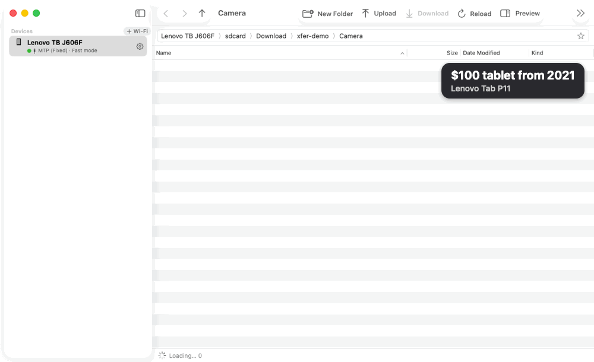

## Why another one?

I used [OpenMTP](https://github.com/ganeshrvel/openmtp) a lot, and it helped me many times — I have
a lot of respect for it. Along with Google's Android File Transfer, it's the open-source app most of
us have used. But folders with thousands of files (usually the camera folder) take a long time to
open, and selecting a range of files with Shift-click has been an
[open request since 2023](https://github.com/ganeshrvel/openmtp/issues/316). The other well-known
apps are paid, and Android File Transfer, even back when it was available, could freeze for tens of
seconds on a big folder. So I made the app I wanted to use.

It's hard to compare apps on speed alone, but SolidFerry is fast enough to enjoy using, with lots
of handy features and options. All in all, I think it's the best choice you can make today.

## Features

### Fast with big folders.

The recording above is a Lenovo Tab P11 — a tablet that sold for about
$100 in 2021, and the slowest device we test with — opening a folder of 10,000 photos. Even there,
over MTP, all 10,000 files show up and are ready to scroll, select and download in 1.9 seconds. On
a Galaxy S23 or Z Flip5 from 2023 — not the newest, about mid-range today — it takes less than half
a second (see [Performance](#performance)). Shift-click to select a range, sorting and multiple
windows work just like in the Finder, and ⌘F searches even tens of thousands of files by name as you
type (a regular expression works too).

### Big files open right away — even a video of several GB.

Photos, videos and music open in a
viewer that reads straight from the phone, as if you were playing them on the phone itself: on the
same $100 tablet a 1.8 GB video starts playing in about a second (0.2 seconds on a Galaxy Z Flip5),
and you can jump to any point without downloading the file first. If the cable comes out while it's
playing, it picks up again when the phone is back. Press Space to view the selected file and Space
again to close it, like Quick Look in the Finder.

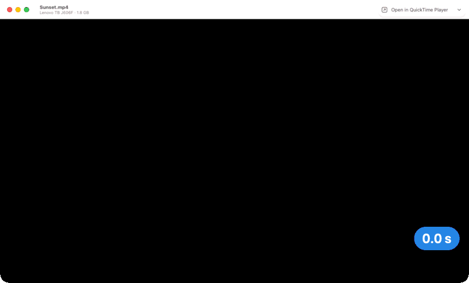

### A preview next to the list.

Photos (using the small picture the phone already keeps, when it
has one), a frame from a video with its length and size, text, the first page of a PDF, album art,
and all the details the phone gives. You choose how much it does: show or hide the panel, stop it
from reading the phone at all (it then shows only what the list already has), see All Details by
group or as raw tags, and set how big a file it will read in full.

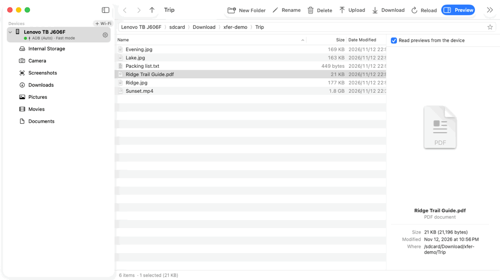

### Transfers you can trust.

- Mac → device, device → Mac and device → device, by drag and drop, copy and paste or menus — all
  in one queue with progress, pause, resume and retry for failed files. Each device works through
  its own jobs, so two phones transfer side by side. The queue is kept when you quit the app, and it
  waits if the connection drops. When nothing is moving it says what it waits for — the phone, or a
  slow disk on your Mac.
- Double-click a transfer for its results: for every file what was there before, what came in,
  what was done and what's there now.
- You never lose existing files: skip, overwrite, keep both, or decide by size, date or content —
  and see exactly what will be copied, skipped or replaced before anything starts. A file that only
  differs by its date can get just the date. An overwrite replaces the old file only after the new
  one has fully arrived.
- Phones that change the date of files they receive can get them as one ZIP that keeps the
  original dates.

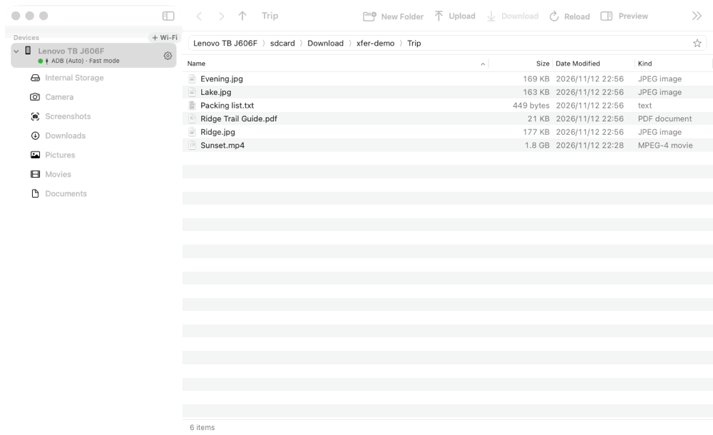

### Easy to connect.

Plug in a phone and it shows up. If USB debugging is on, it uses ADB (faster,
and it can fix some problems by itself); if not, MTP — the "File transfer" mode every phone has.
Wi-Fi works through wireless debugging: pair once, and it connects by itself after that. If
something gets in the way — charging-only mode, the Photos service holding the phone, a prompt
waiting on the phone — the app tells you what it is and what to do.

### Manage files on the device.

New folder, rename, rename many at once (find and replace, numbers,
upper/lower case), delete, hidden files. The sidebar shows each device's usual folders, its SD card
or USB drive, and folders you add yourself (right-click ▸ Add to Sidebar).

### Tabs, windows, and drag and drop between them.

Open folders in tabs or separate windows, from
one device or several, and drag files between them — from the Finder to a phone, from a phone to
the Finder, and even straight from one phone to another.

<table>
<tr>
<td colspan="2">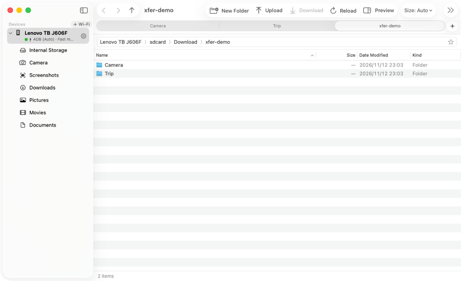<br><sub>Tabs and windows</sub></td>
</tr>
<tr>
<td width="50%">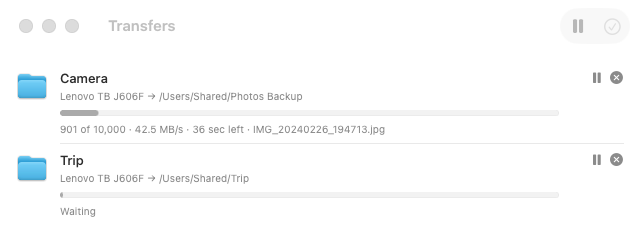<br><sub>One queue for every transfer</sub></td>
<td width="50%">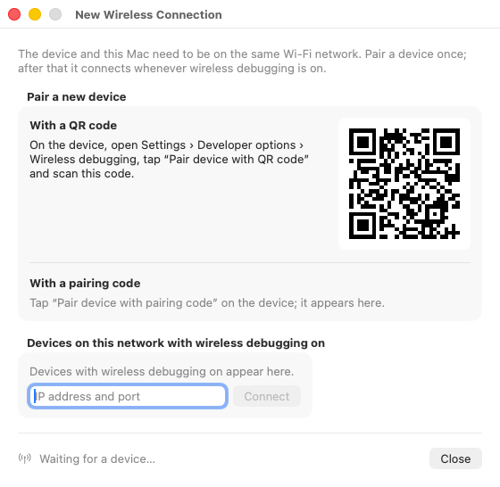<br><sub>Wi-Fi: pair once with a QR code</sub></td>
</tr>
</table>

### Settings to fit how you work.

Transfer options — keep the original dates on phones that change
them, send many small files together in one stream, or write straight to the device without a
temporary file — and options that keep things quick: how big a file the viewer and the preview
open by themselves, and stopping macOS Photos from grabbing a phone when you plug it in, so its
first folder opens right away. You can also set the text size for each part of the window.

<table>
<tr>
<td width="50%">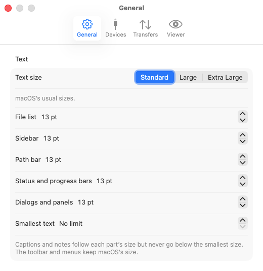<br><sub>General: text size for each part of the window</sub></td>
<td width="50%">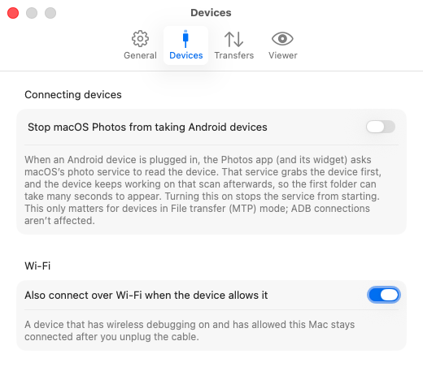<br><sub>Devices: macOS Photos, Wi-Fi</sub></td>
</tr>
<tr>
<td>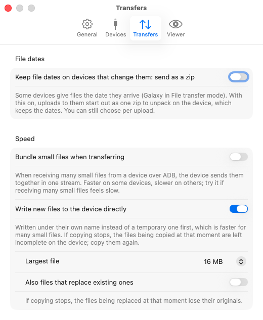<br><sub>Transfers: file dates and speed</sub></td>
<td>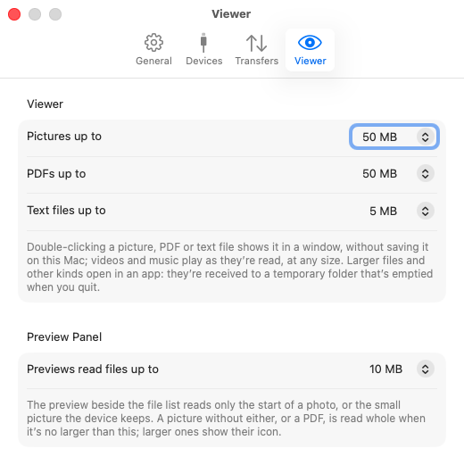<br><sub>Viewer: what opens in the app, and what the preview reads</sub></td>
</tr>
</table>

Available in English and Korean.

## Performance

Over USB; each number is the middle of three runs. The Lenovo Tab P11, a $100 tablet from 2021, is
the slowest device we test with; the Galaxy S10+ is a flagship from 2019; the Galaxy Z Flip5 and S23
(2023) are not the newest, about mid-range today.

| Device | Connection | 10,000-photo folder: first files | Ready to browse | 1.8 GB video: playing |
|---|---|---|---|---|
| Galaxy S23 (2023) | ADB | 0.05 s | 0.9 s | 0.2 s |
| Galaxy S23 (2023) | MTP | 0.2 s | 0.2 s | 0.3 s |
| Galaxy Z Flip5 (2023) | ADB | 0.04 s | 1.9 s | 0.2 s |
| Galaxy Z Flip5 (2023) | MTP | 0.4 s | 0.4 s | 0.2 s |
| Galaxy S10+ (2019) | ADB | 0.1 s | 1.8 s | 0.3 s |
| Galaxy S10+ (2019) | MTP | 1.8 s | 1.8 s | 0.3 s |
| Lenovo Tab P11 ($100 tablet, 2021) | ADB | 0.2 s | 4.1 s | 1.2 s |
| Lenovo Tab P11 ($100 tablet, 2021) | MTP | 1.9 s | 1.9 s | 0.7 s |

"Ready to browse" is when all 10,000 files are in the list and you can scroll, select and download
them. Over MTP the names come first and sizes and dates are filled in afterwards; over ADB sizes and
dates come with the names, so there "ready to browse" means everything has arrived. Folder times
come from the developer tool (`sferry ls`, `sferry mtpfs ls`), which reads folders the same way the
app does; video times are from opening the file in the app until the picture starts moving.

## Install

Download the DMG from [Releases](https://github.com/Jongsic/SolidFerry/releases) and drag
SolidFerry to Applications. Needs macOS 14 or later (Apple Silicon or Intel).

Builds are not notarized yet, so macOS shows a warning the first time you open it:

- **macOS 15 and later**: open SolidFerry and click **Done** in the warning. Then go to
  **System Settings ▸ Privacy & Security**, find *"SolidFerry" was blocked…* and click
  **Open Anyway**.
- **macOS 14**: right-click SolidFerry.app ▸ **Open**, then **Open**.

**On the phone**, do one of these:
- choose **File transfer** in the USB notification after plugging it in (MTP), or
- turn on **USB debugging** in Developer options (ADB). If `adb` isn't installed, SolidFerry can
  download Google's platform-tools for you (used only by SolidFerry).

## Help wanted: devices

SolidFerry is made by one person with only a few devices — some Galaxy phones, Lenovo tablets and a
Teclast tablet ([tested devices](docs/DEVICE_TESTS.md#results-by-device)). Every Android maker
handles MTP and ADB a little differently, and the only way to find out is to try.

**If you have an Android device, please try SolidFerry and
[tell us how it went](../../issues/new?template=device_report.yml)** — even "it just worked on my
Pixel 8" helps. There's also a device test that takes a minute or two and only touches its own
test folder ([how](docs/DEVICE_TESTS.md)).

Anyone can make an app like this with AI now. But what makes one good is working through all the
real devices out there, and that's easier together than alone. Device reports, bug reports and pull
requests are all welcome — see [CONTRIBUTING.md](CONTRIBUTING.md).

## Build from source

To build it you need Xcode 26 (which runs on macOS 15.6 or later) and
[XcodeGen](https://github.com/yonaskolb/XcodeGen).

```sh
brew install xcodegen
make run     # make the Xcode project, build, open
make test    # unit tests
make cli     # sferry, the developer tool (device tests, benchmarks)
```

The Xcode project is made from `project.yml`. For formatting, `adb` and the device tests, see
[CONTRIBUTING.md](CONTRIBUTING.md#development-setup).

## Documentation

- [docs/PRD.md](docs/PRD.md) — what the app is for and how good it needs to be
- [docs/QUIRKS.md](docs/QUIRKS.md) — device and protocol problems the app works around (MTP, ADB,
  Samsung, macOS `ptpcamerad`), with measurements. Handy if you're writing your own MTP or ADB code.
- [docs/DEVICE_TESTS.md](docs/DEVICE_TESTS.md) — the device tests and tested devices

## License

[MIT](LICENSE). Not affiliated with Google. Android is a trademark of Google LLC.
